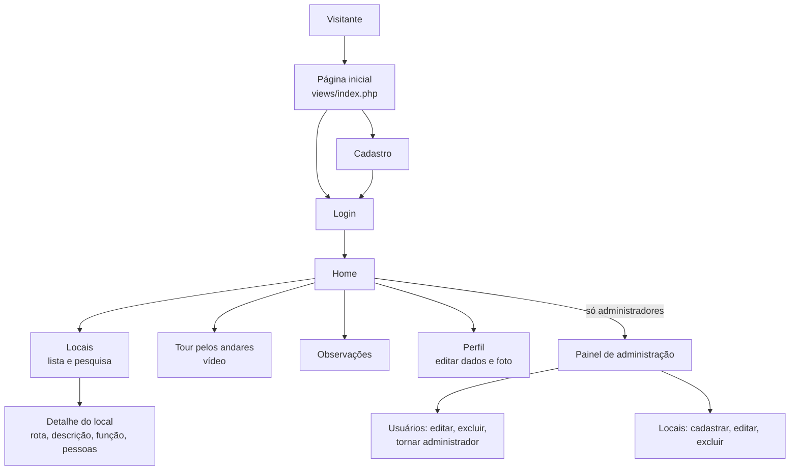

# IFC Guide

Site informativo para os alunos do **Instituto Federal Catarinense – Campus Avançado
Sombrio**. Ele reúne os locais do campus (salas, laboratórios e setores) com a descrição
física de cada um, o caminho para chegar lá, o andar, o bloco e quem frequenta o espaço,
além de um tour em vídeo pelos andares.

Foi o meu projeto integrador do ensino médio técnico, feito em 2022 com PHP, MySQL e
Bootstrap.

## Por que eu fiz isso

Quem chega no campus demora para se achar: não sabe em que bloco fica cada sala, como chegar
num laboratório ou quem trabalha em cada setor. A ideia foi juntar essas informações num
lugar só e escrever, para cada local, uma descrição do ambiente e uma rota em texto ("como
chegar"). Por ser em texto, essa descrição também serve para alunos com baixa ou nenhuma
visão, que podem usar um leitor de tela. Por isso o cadastro pergunta se a pessoa tem
deficiência visual.

## Como funciona



O site é PHP puro, sem framework. As telas ficam em `views/` e os formulários enviam para os
scripts de `php/`, que gravam no MySQL com PDO e voltam para a tela com uma mensagem guardada
na sessão.

O que tem hoje:

- **Cadastro e login** por usuário ou e-mail. A senha precisa ter no mínimo 8 caracteres e é
  guardada com `password_hash`.
- **Locais:** lista em ordem alfabética e página de cada local com andar, bloco, rota, descrição
  física, função, funcionários e professores e alunos que frequentam o espaço. A pesquisa
  procura pelo nome do local, mas só encontra quando o nome é digitado exatamente igual.
- **Andares:** um vídeo do YouTube com o tour geral pelo campus.
- **Observações:** cada usuário pode deixar um texto com necessidades especiais, reclamações
  ou sugestões, e apagar depois.
- **Perfil:** editar nome, usuário, e-mail e senha, enviar uma foto de perfil (até 2 MB) ou
  remover a foto e excluir a própria conta.
- **Painel de administração:** listar, editar e excluir usuários, dar ou tirar o acesso de
  administrador e cadastrar, editar e excluir locais.

## Estrutura

| Caminho | Papel |
|---|---|
| `views/index.php` | Página inicial pública, com a apresentação do projeto |
| `views/cadastro.php`, `views/login.php` | Cadastro e login |
| `views/home.php`, `views/header.php` | Página inicial depois do login e menu |
| `views/locais.php`, `views/local.php` | Lista, pesquisa e detalhe dos locais |
| `views/andares.php` | Tour em vídeo pelos andares |
| `views/obs.php` | Observações do usuário |
| `views/user.php`, `views/editar-user.php` | Perfil e edição do perfil |
| `views/gerenciarpaineis.php`, `views/painel-*.php` | Painéis de administração |
| `views/cadastro-local.php`, `views/editar-local.php`, `views/adm-editar-users.php` | Formulários do administrador |
| `php/config.php` | Conexão com o MySQL |
| `php/getusers.php` | Inicia a sessão e carrega o usuário logado, os andares e os locais |
| `php/recebe*.php`, `php/editar*.php`, `php/delete*.php`, `php/admin*.php` | Processam os formulários |
| `assets/css/`, `assets/images/` | Estilos e imagens |

## Banco de dados

O banco se chama `usuario`, e alguns scripts usam esse nome direto nas consultas
(`usuario.usuario`), então ele precisa ter exatamente esse nome. As tabelas são:

| Tabela | Colunas |
|---|---|
| `usuario` | `id`, `nome`, `user`, `email`, `senha`, `admuser`, `defvisual`, `obs` |
| `usuarioimagem` | `id`, `userimagem`, `iduser` |
| `andar` | `id`, `andar` |
| `locais` | `id`, `nome`, `funcao`, `descricaofisica`, `rota`, `funcionarios`, `alunos`, `idandar`, `bloco` |
| `sistema` | `userid` (registra cada login) |

O dump do banco não está mais no repositório, então deixo aqui um script com a estrutura que
o código usa:

```sql
CREATE DATABASE usuario;
USE usuario;

CREATE TABLE andar (
  id INT NOT NULL PRIMARY KEY,
  andar VARCHAR(45) NOT NULL
);
INSERT INTO andar VALUES (1, '1º andar'), (2, '2º andar'), (3, '3º andar');

CREATE TABLE locais (
  id INT NOT NULL AUTO_INCREMENT PRIMARY KEY,
  descricaofisica VARCHAR(1000) NOT NULL,
  funcionarios VARCHAR(200) NOT NULL,
  nome VARCHAR(45) NOT NULL,
  funcao VARCHAR(200) NOT NULL,
  idandar INT NOT NULL,
  bloco VARCHAR(20) NOT NULL,
  alunos VARCHAR(200) NOT NULL,
  rota VARCHAR(500) NOT NULL
);

CREATE TABLE usuario (
  id INT NOT NULL AUTO_INCREMENT PRIMARY KEY,
  nome VARCHAR(100) NOT NULL,
  user VARCHAR(50) NOT NULL,
  email VARCHAR(100) NOT NULL,
  senha VARCHAR(250) NOT NULL,
  admuser TINYINT(1) NOT NULL DEFAULT 0,
  defvisual TINYINT(1) DEFAULT 0,
  obs TEXT
);

CREATE TABLE usuarioimagem (
  id INT NOT NULL AUTO_INCREMENT PRIMARY KEY,
  userimagem VARCHAR(200) NOT NULL DEFAULT '../assets/images/userimg.png',
  iduser INT
);

CREATE TABLE sistema (
  id INT NOT NULL AUTO_INCREMENT PRIMARY KEY,
  userid INT NOT NULL
);
```

## Instalação

Usei o XAMPP (Apache, PHP e MySQL). Qualquer ambiente com PHP e MySQL serve.

1. Copie a pasta do projeto para dentro do `htdocs` do XAMPP, por exemplo
   `C:\xampp\htdocs\TCC`.
2. Crie a pasta `assets/images/userimg/`, onde ficam as fotos de perfil. Ela está no
   `.gitignore`, então não vem no clone.
3. Rode o script SQL acima no MySQL (pelo phpMyAdmin ou pelo terminal).
4. Se o seu MySQL não usar o usuário `root` sem senha, ajuste `php/config.php`.

## Uso

Abra <http://localhost/TCC/views/index.php>, crie uma conta e faça login.

Ninguém começa como administrador. Para liberar o painel para a primeira conta, rode no MySQL:

```sql
UPDATE usuario.usuario SET admuser = 1 WHERE user = 'seu_usuario';
```

Depois disso, o próprio painel permite cadastrar os locais e dar acesso de administrador
para outras pessoas.

## Próximos passos

- Fazer a pesquisa encontrar partes do nome (hoje o `LIKE` não usa `%`, então só acha o nome
  exato).
- Conferir a permissão de administrador em todos os pontos: os scripts de exclusão e edição
  (`php/admin-deleteuser.php`, `php/admin-deletelocal.php`, `php/admin-editaruser.php`,
  `php/recebelocal.php`, `php/editarlocal.php`) e a tela `views/cadastro-local.php` hoje não
  checam se quem acessa é administrador.
- Usar a informação de deficiência visual do cadastro para adaptar o site, por exemplo com
  um modo de alto contraste.
- Implementar as funções que a página inicial apresenta e que ainda não existem, como
  horários dos cursos e calendário acadêmico.
- Versionar o script do banco no repositório.
